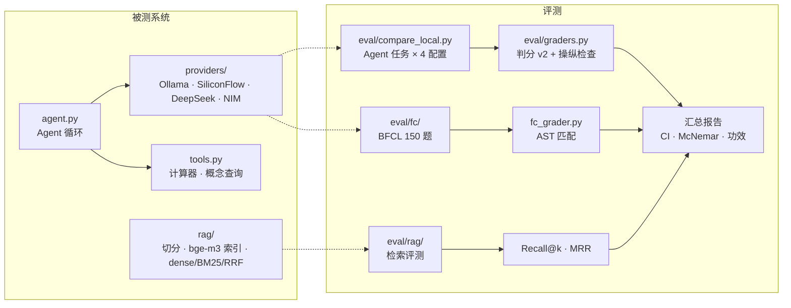

# 本地大模型评测平台(Interview Agent Demo)

在一块 6 GB 显卡上,对本地部署的大模型做**有统计依据、可复现、能自查判分错误**的评测:
函数调用(BFCL)、Agent 工具任务、中文 RAG 检索。重点不是"跑出一个分数",而是回答三个问题:

1. **差异是真的吗?** 配对检验 + 检验功效,"不显著"时说清楚能检出多大的差距;
2. **判分是对的吗?** 标准答案自洽测试、操纵检查、数据血缘,一天内查出 4 类不会报错的评测缺陷;
3. **该怎么选?** 准确率按成本决策,并写明证据的边界。

---

## 主要结果

**函数调用(BFCL v4 分层抽样 150 题,含 100 道真实用户 live 题、35 道不应调用题)**

| 配置 | 准确率 [95% Wilson CI] | 非 live (50) | live (100) | 每题耗时 | 输出 token |
|---|---|---|---|---|---|
| Qwen3-4B-Instruct-2507,不思考 | **84.0%** [77.3, 89.0] | 48/50 | 78/100 | 3.3 s | 72 |
| Qwen3.5-4B,不思考 | 79.3% [72.2, 85.0] | 47/50 | 72/100 | 3.8 s | 95 |

- 主要比较(事先指定,精确 McNemar):不一致 9 : 16,**p = 0.23,不显著**。
- 检验功效:不一致比例约 17%,150 题能检出的最小差距约 **9.5 个百分点**;要以 80% 功效检出 5 个百分点约需 **480 题**。
- 决策:准确率打平,默认选 Qwen3-4B-Instruct(更快、更省 token、两份评测方向一致),标注"暂定"。

**Agent 工具任务(自建 12 题 × 3 次,真实执行工具)**

| 配置 | 成功率 [95% CI] | 每题耗时 | 实测显存 | 生成速度 |
|---|---|---|---|---|
| Qwen3-4B-Thinking,思考 | 97.2% [91.7, 100] | 17.8 s | 3,153 MiB | 87 tok/s |
| Qwen3-4B-Instruct,不思考 | 91.7% [75.0, 100] | 6.4 s | 3,148 MiB | 82 tok/s |
| Qwen3.5-4B,思考 | 100% [100, 100] | 13.5 s | 3,761 MiB | 77 tok/s |
| Qwen3.5-4B,不思考 | 94.4% [86.1, 100] | 9.2 s | 3,767 MiB | 77 tok/s |

- 开思考在两份评测中都没有显著提升,耗时 1.5–2.8 倍 → 默认关闭。
- 实测显存与公式估算吻合:权重约 2.4 GiB + KV cache(2 × 36 层 × 8 个 KV 头 × 128 维 × 2 字节 = 144 KiB/token,× 4096 = 576 MiB)+ 计算缓冲 ≈ 3,150 MiB。

**中文 RAG 检索(26 块语料,25 道可答题 + 5 道查不到的题)**

| 模式 | Recall@1 | Recall@5 | MRR@10 |
|---|---|---|---|
| 向量(bge-m3) | 64% | 92% | 0.748 |
| BM25(jieba + 自定义词典) | 60% | 88% | 0.733 |
| 混合(RRF) | 60% | 92% | 0.746 |

- 三种模式两两 McNemar p = 1.0:语料太小(Recall@5 的随机基线已有 19%),这一版只用来跑通流程。
- **相似度阈值拒答不可行**:可答题最高余弦 0.539–0.685,查不到的题 0.480–0.596,区间重叠;要拒掉全部查不到的题,会误拒约一半可答题 → 拒答交给生成阶段。

---

## 评测可信度:查出并修复的问题

这些问题**都不会报错**,都是从"异常模式"和原始记录里发现的。每一个都加了单元测试或自动检查。

| 问题 | 发现信号 | 根因 | 防范 |
|---|---|---|---|
| 判分器冤枉模型 | 4 个有效配置第一版共 17 个失败,其中 11 个是误判 | 只看第一次工具调用(重试成功被判错);关键词列表漏词 | 改为按结果判分;每种误判写成回归测试 |
| "关思考"没生效 | 关思考的回答里出现 `</think>`(36/36) | Qwen3-4B 是只会思考的 Thinking-2507 | **操纵检查**:无效配置不进入比较;对照改用 Instruct 版 |
| 假数据混入结果 | 4 个配置在同 6 题上参数全为空 | 试跑结果被提交,续跑逻辑当成已完成 | 每行记录 run_id、服务地址、Ollama 版本;汇总时标出耗时异常的行 |
| 嵌套参数误判 | 4 个配置在同一题全错 | 标准答案没有逐层展开 | **自洽测试**:每道题的标准答案必须通过判分器 |
| 截断被判为对 | 输出达到 2048 token 上限 | 思考耗尽预算、没来得及调用,被"不调用即正确"判对 | 截断一律判失败(与 BFCL 官方不同,已注明) |
| 输入被静默截断(预防) | — | 超过 num_ctx 时 Ollama 不报错 | num_ctx 提到 8192;检查输入 token 数 |
| BM25 零分块混入 | 署名行排进检索前 5 | 零分块之间顺序任意,在 RRF 里还白拿分数 | 只返回分数 > 0 的块 |

共同规律:**几个配置在同一题上全错,先怀疑题目和管线,再怀疑模型。**

---

## 方法要点

- **预注册**:跑之前写下预测,事后对照(见 [`eval/results/predictions.md`](eval/results/predictions.md),10 条只对 2 条)。
- **事先指定一个主要比较**,其余标为探索性,避免多重比较。
- **配对设计**:同题同种子;二元结果用精确 McNemar,连续分数用按题配对 bootstrap(按题重抽样,而不是按运行次数)。
- **报告检验功效**:"不显著"同时报最小可检出差距 Δ_min ≈ √(7.84·d / n)。
- **原始输出只存一次,判分可反复重算**:改判分规则不用重跑模型。
- **标注与实现解耦**:检索评测按"证据原文"标注,换切分参数不失效;打分前先检查标注本身。
- **索引带版本清单**:embedding 模型、Ollama 版本、块文件哈希;块和向量对不上就拒绝加载。

---

## 结构



```
agent.py              Agent 循环:推理 → 工具调用 → 观察,直到最终回答或步数上限;"大脑"可插拔
providers/            Ollama(本地,可开关思考、返回 prefill/decode 计时)与三个 OpenAI 兼容 API
router/               路由 Agent 的三个工具(notes_search / jobs_query / web_search)、岗位表、搜索后端与回放;cli.py 日常入口
rag/                  ingest.py 切分 · index.py 向量化与清单 · retrieve.py 三种检索 · text.py 中文分词
eval/
  compare_local.py    本地模型 4 配置对比(每配置前卸载模型测显存基线,可断点续跑)
  graders.py          判分 v2 与操纵检查
  fc/                 BFCL 子集构建、AST 判分、运行、汇总、单题 Trace 查看
  rag/                检索评测集(按证据原文标注)与评测脚本
  agent_faults/       故障注入评测:注入器、判分(5 类结果)、虚构数据、运行与汇总(按题聚类 bootstrap)
  datasets/           评测数据(来源、协议、抽样方式见 README)
  results/            定稿报告与事先预测
tests/                54 项单元测试:测"评测工具本身"对不对(判分器、解析、切分、检索)
```

---

## 复现

```bash
pip install -r requirements.txt
python -m pytest -q                                   # 54 passed

# 函数调用评测(需要 Ollama 和 qwen3:4b-instruct、qwen3.5:4b)
python eval/fc/run_fc.py && python eval/fc/summarize_fc.py

# 本地模型 Agent 任务对比
python eval/compare_local.py && python eval/summarize_local.py

# RAG:把 Markdown 笔记放进 data/notes/(不进仓库),需要 ollama pull bge-m3
python -m rag.ingest data/notes && python -m rag.index
python -m rag.retrieve "McNemar 检验怎么算" --mode hybrid
python eval/rag/eval_retrieval.py

# 路由 Agent 故障注入评测(先用假大脑验证管线,再跑真模型)
python eval/agent_faults/run_faults.py --brain mock-robust --out eval/results/faults_mock.jsonl
python eval/agent_faults/run_faults.py --brain ollama --config qwen3i-nothink --prompt guided
python eval/agent_faults/summarize_faults.py eval/results/faults_qwen3i-nothink_guided.jsonl
```

用 API 模型跑 Agent 评测:设置 `SILICONFLOW_API_KEY` 后运行 `python eval/run_eval.py --mode real --provider siliconflow && python eval/score.py`。

---

## 局限与下一步

- [ ] **RAG 生成阶段**:带引用回答、查不到就拒答,测编造率与误拒率
- [ ] **重排消融**:交叉编码器重排对 Recall@1 的提升
- [ ] **LLM-as-Judge**:人工标注校准(Cohen's κ),检查位置偏差与同源偏差,替换关键词判分
- [x] **路由 Agent**:笔记(RAG)/ 岗位表(结构化查询)/ 搜索三个工具已接入 Agent 循环(`router/`)
- [ ] **故障注入评测**:5 类故障 × 24 题,按类别统计恢复率与编造率——框架和假大脑验证已完成(`eval/agent_faults/`),真模型结果待跑
- [ ] 比较 workflow 与 agent 的成功率和成本
- [ ] **扩大评测集**到约 480 题,加入中文工具调用(T-Eval);块大小实验改用固定 token 预算
- [ ] **服务化**:FastAPI + Redis 任务队列 + Docker + CI,并发压测

已知局限:Agent 任务只有 12 题,置信区间很宽;BFCL 判分是简化版 AST 匹配,与官方实现可能有细微差异;各配置用官方推荐采样参数,模型差异与采样差异混在一起。

---

## 附:Agent 循环设计

`agent.py::run_agent()` 是唯一的控制流循环,只认一个接口:

```python
decide_fn(task: str, history: list) -> decision
# {"action": "final_answer", "content": ...}  或  {"action": "tool_call", "calls": [...]}
```

换"大脑"(规则假大脑、Anthropic、Ollama、SiliconFlow、DeepSeek、NVIDIA NIM)不用改循环一行。
评测任务里专门设计了"工具报错"的题(除以 0、查不存在的术语),检验 Agent 会不会**编造一个看起来成功的结果**——
这比"不会用工具"更危险,因为乍看像成功了。

`tests/` 和 `eval/` 测的是两件事:前者测代码对不对(软件正确性),后者测模型能力(有随机性,要用统计方法)。
